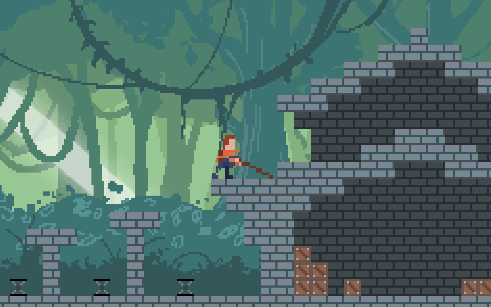

# Prv-Java-GameEngine

Eine selbstentwickelte, eigenständige **2D-Game-Engine in Java** – konzipiert und implementiert im Rahmen einer GFS (Gleichwertige Feststellung von Schülerleistungen) in der 11. Klasse. 

Das primäre Ziel dieses Projekts war die Entwicklung einer vollständigen Spiel-Engine von Grund auf ("from scratch") ohne den Einsatz externer Bibliotheken oder Frameworks. Als alleinige Grundlage diente das Standard-JDK (u. a. Java Swing für das Rendering).

---

## Core Features

* **Zero External Dependencies:** Vollständig in Java entwickelt, ohne Dritthersteller-Bibliotheken (kein LWJGL, keine externen Physik-Engines).
* **Eigenentwickelte Physik & Kollisionsabfrage:** Sämtliche Bewegungsabläufe, Gravitationsberechnungen und Kollisionserkennungen wurden mathematisch und logisch selbst programmiert.
* **Modulares Entitätssystem:** Flexible Architektur zur Unterstützung verschiedener Entitätsarten und dynamischer Interaktionen.
* **Power-Up System:** Integrierte Mechanik zur Handhabung und Ausführung von Spiel-Power-Ups.
* **Grid- & Block-basiertes Leveldesign:** Strukturierte Blockbildung zur Erstellung von 2D-Platformer-Welten.
* **Audio-Integration:** Eingebauter Sound-Support für Toneffekte und Musik.

---

## Technische Architektur

* **Sprache:** Java (JDK Standard Library)
* **Rendering:** Java Swing (Grafik- und Render-Pipeline eigenständig umgesetzt)
* **Struktur:** Getrennte Module für Engine-Core, Rendering, Physik, Entitäten und Sound.

---

## Projektstruktur

Das Repository beinhaltet sowohl den Quellcode der eigentlichen **Game Engine** als auch ein **Testprogramm / Beispielspiel**, welches die Funktionen und Mechaniken in der Praxis demonstriert.

---

## Vorschau

---

## Starten des Projekts

1. Klonen oder Herunterladen des Repositories:
   git clone https://github.com/E1ario/Prv-Java-GameEngine.git
2. Projekt in eine Java-IDE (z. B. IntelliJ IDEA, Eclipse) importieren.
3. Die Hauptklasse des Testprogramms ausführen.
